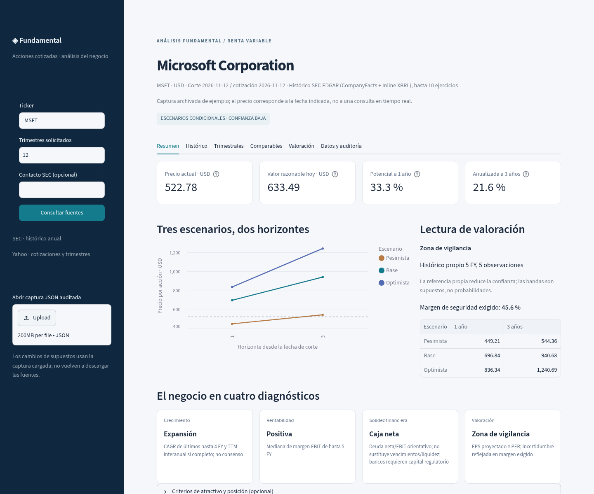
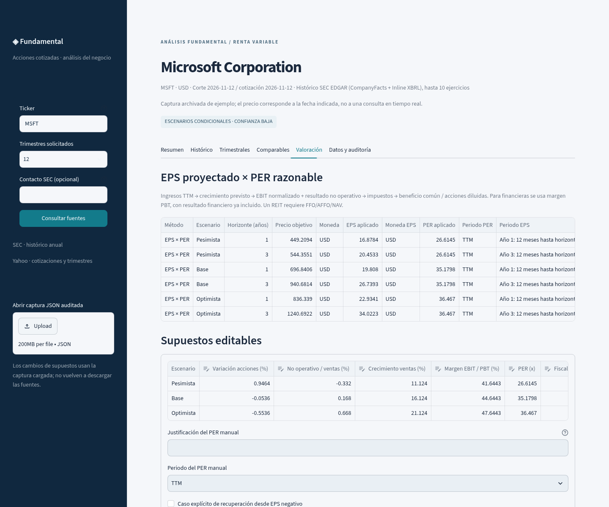

# V6 simplificada · dashboard fundamental de acciones

Actualización de la [PR #1](https://github.com/AlvaroAlonsoLarre/valoracion-bursatil/pull/1), rama `fix/auditoria-msft-sk-hynix`, sin fusión a `main`. Fecha de corte: 12 de noviembre de 2026. La V6 conserva los informes anteriores como evidencia histórica; no convierte sus cifras en resultados de esta versión.

## Comportamiento y fórmulas

La pantalla principal pasa a **EPS proyectado × PER razonable**, con escenarios Pesimista/Base/Optimista y horizontes de uno y tres años. El Resumen muestra cotización fechada, valor razonable de referencia, potencial a un año, retorno de precio anualizado a tres, los tres escenarios y diagnósticos de crecimiento, rentabilidad, solidez y valoración. El dashboard contiene exactamente seis pestañas: Resumen, Histórico, Trimestrales, Comparables, Valoración y Datos y auditoría.

La proyección utiliza ingresos TTM completos; crecimiento mecánico de los últimos hasta cuatro FY y TTM interanual si hay ocho trimestres; mediana de margen de hasta cinco FY; resultado no operativo normalizado PBT−EBIT; fiscalidad publicada interpretable; y acciones diluidas, distintas de las acciones al cierre. Los supuestos y su origen se muestran y se editan por escenario. Ningún parámetro se ajusta para acercar el objetivo a la cotización.

Para cada escenario y año `h`:

```
Ingresos_h = ingresos_TTM × (1 + crecimiento)^h
EBIT_h = ingresos_h × margen_normalizado
PBT_h = EBIT_h + ingresos_h × ratio_no_operativo
Impuestos_h = max(PBT_h, 0) × tasa_fiscal
Beneficio_común_h = (PBT_h − impuestos_h) × puente_común_diluido
Acciones_diluidas_h = acciones_diluidas_base × (1 + variación_acciones)^h
EPS_h = beneficio_común_h / acciones_diluidas_h
Precio_h = EPS_aplicable × PER × FX × ordinarias_por_ADR
```

El puente común/diluido procede de EPS × acciones diluidas / beneficio neto de FY, con cobertura y estabilidad exigidas; no presume cero minoritarios. No se inventan créditos fiscales en pérdidas. Un PER TTM se aplica al EPS de los doce meses hasta el horizonte; un PER NTM al EPS del año posterior (años 2 y 4 para valorar a 1 y 3). Los ingresos TTM disponibles son una base informativa a la fecha de corte, no un dato de ventas futuras ni un consenso.

Si falta una serie EBIT suficiente, se identifica **PBT directo normalizado**, con el resultado financiero incluido, sin sumar otro financiero ni fabricar EBIT. JNJ utiliza esta ruta. Las financieras, como JPM, también usan PBT directo y requieren revisar capital regulatorio y provisiones; no se les aplica FCFF/EV/FCF genérico ni se emite una señal automática de compra. Los REIT requieren FFO/AFFO/NAV documentados. EPS negativo no genera precio por PER salvo un caso de recuperación expresamente justificado con EPS futuro positivo.

El valor razonable de referencia hoy es `precio Base a 1 año / (1 + retorno exigido)`. No es una media entre PER, DCF y FCF. El potencial a un año es `precio_1/precio_actual − 1`; la anualizada a tres es `(precio_3/precio_actual)^(1/3) − 1`. No incluyen dividendos, impuestos personales ni costes.

## Referencias históricas, comparables y contraste FCF

SEC sigue siendo la fuente anual principal; Yahoo aporta precios, trimestres, acciones corporativas y complementos. Se conservan estadísticas y cobertura de cinco y diez ejercicios. Los precios Close no se ajustan por dividendos. Se concilian EPS, acciones y beneficio común/continuado y se ajustan splits posteriores al filing que publicó cada dato. Se preservan fechas fiscales reales; los cierres de primera semana de enero se etiquetan como el FY de diciembre para evitar índices duplicados y CAGR incorrecto en calendarios de 52/53 semanas. Sin FX histórico o puente histórico ADR no se producen múltiplos incompatibles. GBP/GBp/GBX conservan un factor de unidad explícito.

El PER propio usa mediana/cuartiles de cinco FY con mínimo tres observaciones positivas conciliadas, o diez FY con mínimo cinco. Se identifica **confianza Baja**, referencia retrospectiva, no backtest con información disponible en cada fecha. Los EPS continuados publicados se prefieren para evitar extrapolar operaciones interrumpidas, sin inventar una definición cuando falta el dato.

Se descubren candidatos por actividad y se seleccionan preferentemente tres a seis; no se fuerza el mínimo. Los candidatos sin descarga se conservan también en la captura y en el replay. La evidencia de PER TTM y NTM se valida por separado. TTM requiere cuatro trimestres consecutivos, fechas compatibles, marco contable contrastado, moneda/acción compatibles, conciliación del beneficio común con EPS diluido y revisión de grandes diferencias con el beneficio normalizado del proveedor. Este último sólo es una comprobación de diferencias; no reemplaza el beneficio reportado. La ponderación de acciones diluidas TTM por días aproximados se declara.

Para NTM se mantienen los controles de evidencia, hash, emisor, fechas, ventana exacta, GAAP/IFRS, moneda/FX y acción/ADR. `forwardPE`, FY1 y estimaciones `normalized` no se transforman en GAAP NTM. Se exigen al menos tres emisores independientes y se rechazan referencias excesivamente dispersas. Cuando no se alcanza la cobertura documental/económica necesaria se usa el histórico propio con menor confianza.

**Precio/FCF** es un contraste actual de equity, no EV/FCF ni una proyección automática: `FCF_TTM/acciones_diluidas × mediana(P/FCF histórico)`. Requiere CAPEX completo, OCF−CAPEX positivo, al menos tres FY positivos y conversión FCF/neto entre 0,5 y 2. Los métodos que no cumplen quedan N/D sin bloquear otros.

## Controles, simplificación y exportación

Se retiran del flujo principal los generadores heredados de EPS compuesto × PER medio y FCF extrapolado. Se elimina la pantalla de siete pestañas con resultados duplicados. El modelo anterior se conserva para DCF/EV opcionales y replay de auditorías antiguas. Los análisis opcionales se ejecutan en proceso aislado para que los overrides de riesgo de una sesión no contaminen otra. Su disponibilidad se registra independientemente: ni un DCF fallido invalida EPS suficiente ni la falta de PER oculta un DCF opcional disponible. No se promedian métodos ni se cambia automáticamente la valoración principal.

`CRITICO` bloquea el ámbito afectado; `ADVERTENCIA` identifica límites informativos. Se conservan controles de TTM/YTD, duplicados, conciliación FY, actualidad, divisas, capitalización/acciones, diluted/common, ADR, pérdidas y publicación posterior confirmada. Un precio sin fecha válida no permite potenciales ni señales aunque se pueda proyectar EPS. No se rellena CAPEX/D&A ausente con cero ni con ratios para autorizar FCFF.

SK hynix sigue sin tener reconciliados CAPEX total Q3 y las dos definiciones de D&A. **La V6 no resuelve ni borra esos pendientes**: EPS normalizado no depende de ellos; FCF y DCF conservan sus restricciones. Si falta EPS TTM publicado, se exige signo positivo del neto TTM y puente común FY para utilizar el modelo de EPS normalizado, sin rellenar el EPS reportado.

Los criterios de atractivo son editables: retorno exigido, margen de seguridad, prima para reducir, penalización por incertidumbre, caída tolerada y peso máximo. La confianza Baja y la dispersión incrementan el descuento exigido; la incertidumbre reduce la caída tolerada. Una posición introducida en moneda de cotización permite reglas orientativas de comprar/mantener/ampliar/reducir/vender. El coste sólo afecta a la plusvalía informativa. No hay órdenes automáticas ni señales presentadas como garantías.

Excel, resultados JSON y captura JSON contienen los supuestos visibles y los mismos precios. Recalcular no consulta red. Se corrigió la mutación del payload JSON al leer un snapshot para que el replay con `--assumptions`/`--advanced` pueda exportar también la nueva captura. La prueba de integración reproduce ese recorrido completo.

## Evidencia de ejecución

Código financiero ejecutado: `b035a251ccd5302e5d5c5a9fc7fc69435d2b20e0`. [Actions 43239225158](https://github.com/AlvaroAlonsoLarre/valoracion-bursatil/actions/runs/43239225158): **90 pruebas, las tres suites originales, MSFT, 000660.KS, JNJ, JPM y cobertura, todo en success**. Los cinco ZIP se descargaron y sus digest/tamaños coinciden con GitHub: [artefactos](artefactos.json), [pruebas](pruebas_actions.txt), [cobertura](cobertura.json). Todos los precios conservan estado condicional y `publicable=false`.

Las ejecuciones iniciales en Actions alcanzaron la valoración usando el fallback de Yahoo (4/5 FY) porque `www.sec.gov/files/company_tickers.json` devolvía 403. Se detectó al inspeccionar los artefactos, sin confundir éxito técnico con cobertura SEC. La resolución alternativa usa el CIK de un enlace de filing reportado por el SDK y **exige ticker exacto y CIK coherente en submissions oficial**. Los estados financieros siguen descargándose de SEC. Se verificó también con red real simulando sólo la denegación del índice. No hay CIK ni cifras financieras inventados ni un correo ficticio.

La ejecución final recupera **10 FY SEC para cada una de las tres compañías estadounidenses**. SK mantiene 4 FY de Yahoo y Q3 oficial IR, con cobertura explícita incompleta. La diferencia entre las ejecuciones de fallback y SEC se debe a la cobertura/definición de las entradas históricas, no a una recalibración hacia la cotización.

También se ejecutaron los cuatro tickers localmente con red autorizada sobre `b28ee6b…`; las correcciones posteriores resolvieron trazabilidad del descubrimiento, exportación de replay y acceso a identidad SEC en Actions. Las nuevas funciones de valoración no se ajustaron para cambiar sus resultados frente al mercado.

Precios del escenario Base de la ejecución final (hipótesis de PER histórico propio, confianza Baja):

| Ticker | Moneda | Cotización capturada | Base 1 año | Base 3 años | Potencial 1 año | Anualizada 3 años |
|---|---|---:|---:|---:|---:|---:|
| MSFT | USD | 522.78 | 696.84 | 940.68 | 33.30% | 21.63% |
| 000660.KS | KRW | 1,254,000.00 | 976,869.50 | 1,602,159.41 | -22.10% | 8.51% |
| JNJ | USD | 282.41 | 234.23 | 282.74 | -17.06% | 0.04% |
| JPM | USD | 344.85 | 290.93 | 383.68 | -15.63% | 3.62% |

Cada emisor tiene **seis objetivos principales**; MSFT/SK/JPM no tienen un contraste FCF representativo y JNJ sí. No se han obtenido tres emisores con evidencia homogénea suficiente por múltiplo en estos casos: se usa la alternativa histórica autorizada, con 5/3/5/5 observaciones respectivamente. Los pares económicos seleccionados son 1/6/0/6; no se sustituyen los faltantes por empresas de otro negocio. Los ratios observados sin prueba compatible permanecen fuera de la referencia.

## Comparación con la versión anterior

Se utilizó el código previo `0faccd1d832d985b7817b999a3ee821d9b24d0b6` sobre **las mismas entradas finales**, sin consultar red, y se comparó con la V6. [Comparación completa](comparacion_antes_despues.csv) y [24 fórmulas independientes](formulas_eps_independientes.csv); los JSON antes/después y los opcionales están en `resultados/`. El verificador vuelve a calcular crecimiento de ingresos, PBT, fiscalidad, puente común, dilución, EPS y precio para cada escenario y horizonte. Tolerancia relativa 1e-12.

| Emisor | Antes: precios PER forward / DCF disponibles | V6: precios EPS × PER | Restricción que permanece |
|---|---:|---:|---|
| MSFT | 0 / 9 | 6 | DCF y PER divergen por reinversión, descuento y referencia de múltiplo; FCF no representativo |
| SK hynix | 0 / 0 | 6 | DCF conserva sus tres bloqueos de CAPEX/D&A/integridad; FCF sigue N/D |
| JNJ | 0 / 0 | 6 | PBT directo explícito; sin serie EBIT suficiente; DCF no obtiene precios |
| JPM | 0 / 0 | 6 | Modelo financiero; capital regulatorio no evaluado y sin FCFF genérico |

El DCF Base de MSFT con estas entradas es 163,212826 a un año y 174,488096 a tres; **es idéntico en el motor anterior y el opcional actual**. Difiere ligeramente de las cifras de la auditoría anterior por las nuevas entradas de mercado/descuento. El EPS/PER Base de 696,840627 / 940,681442 corresponde a otro método: no representa una reparación aritmética del DCF ni demuestra que el valor intrínseco sea ese. El PER histórico no modela directamente la reinversión; la intensidad de CAPEX de Microsoft es un riesgo material de esa referencia. Por ello se conserva el contraste opcional y no se promedian los resultados.

## Pruebas y revisión visual

Las 35 pruebas añadidas a las 55 anteriores cubren fórmulas EPS/PER, NTM frente a TTM, independencia de métodos en ambas direcciones, pérdida actual/futura, fiscalidad sin créditos ficticios, acciones diluidas conflictivas, precio/FX/capitalización, ADR, peniques, splits, operaciones continuadas, calendarios semanales, fuente SEC futura, ticker exacto/CIK y 403 del índice, FCF de equity y representatividad, reglas sensibles a incertidumbre y posición, inmutabilidad JSON, replay CLI editado y paridad Excel/JSON. AppTest comprueba seis pestañas, cuatro métricas y recálculo de criterios. Las dos advertencias de pytest corresponden al caso simulado de denegación del índice SEC.

En Chromium/Playwright se comprobaron escritorio de 1440 px y móvil de 390 px, sin errores de página ni desbordamiento horizontal. Se cambió el retorno exigido de 10% a 20%: el valor razonable pasó de 633,49 a 580,70 USD y el precio futuro EPS/PER se mantuvo. Se descargaron los tres formatos desde la interfaz; Excel y JSON coinciden y el SHA-256 de la captura exportada coincide con su resumen. [Evidencia de navegador](navegador.json).





[Captura móvil](capturas/movil.png)

## Reproducción y límites

```bash
python -m pytest -q tests
python autoprueba_modelo.py
python prueba_comparables_automaticos.py
python test_v5.py
streamlit run dashboard_app.py
python ejecutar_analisis.py --snapshot docs/v6_simplificada_2026-11-12/inputs/MSFT_after.json --outdir Resultados/replay_MSFT
python ejecutar_analisis.py --snapshot docs/v6_simplificada_2026-11-12/inputs/000660.KS_after.json --advanced --outdir Resultados/replay_SK
python docs/v6_simplificada_2026-11-12/verificar_v6.py
```

El verificador necesita el objeto Git de la versión previa (clon con historial), o `--baseline-dir` con ese checkout. No consulta red. Los snapshots y archivos de evidencia tienen sus hashes en [sha256.json](sha256.json). El último commit del informe sólo añade documentación/capturas; el código ejecutado es el identificado arriba.

Quedan limitaciones económicas: previsiones mecánicas, ausencia de consenso homogéneo suficiente, continuidad de márgenes y dilución, extraordinarios, reinversión/caja distribuible y requisitos sectoriales. En SK no se ha completado el CAPEX/D&A oficial pendiente. En JPM no se ha validado CET1/provisiones. No se simula cobertura FFO/AFFO para REIT. Las cifras son escenarios de decisión condicionados a esas hipótesis, no garantías ni órdenes de compra. `main` no se ha modificado ni se ha activado auto-merge.
